<div align="center">


# AzerothCore Server Manager

### Your own World of Warcraft 3.3.5a server with hundreds of AI players, built and managed with a few clicks

**AzerothCore Control Center** is a Windows app that builds and manages
[AzerothCore](https://www.azerothcore.org/) private servers with
[Playerbots](https://github.com/mod-playerbots/mod-playerbots): AI players that quest, level, trade,
run dungeons and fight in battlegrounds alongside you. You don't need any programming knowledge.

[](https://github.com/clawdroppin/AzerothCore-ServerManager/releases/latest)
[](LICENSE)
[](#-requirements)
[](#-for-developers-and-ai-agents)
[-c774ff?style=for-the-badge&labelColor=161922)](#-requirements)

[**⬇ Download**](https://github.com/clawdroppin/AzerothCore-ServerManager/releases/latest) ·
[Quick start](#-quick-start) ·
[Features](#-features) ·
[Screenshots](#-screenshots) ·
[FAQ](#-faq--troubleshooting) ·
[For developers & AI agents](#-for-developers-and-ai-agents)

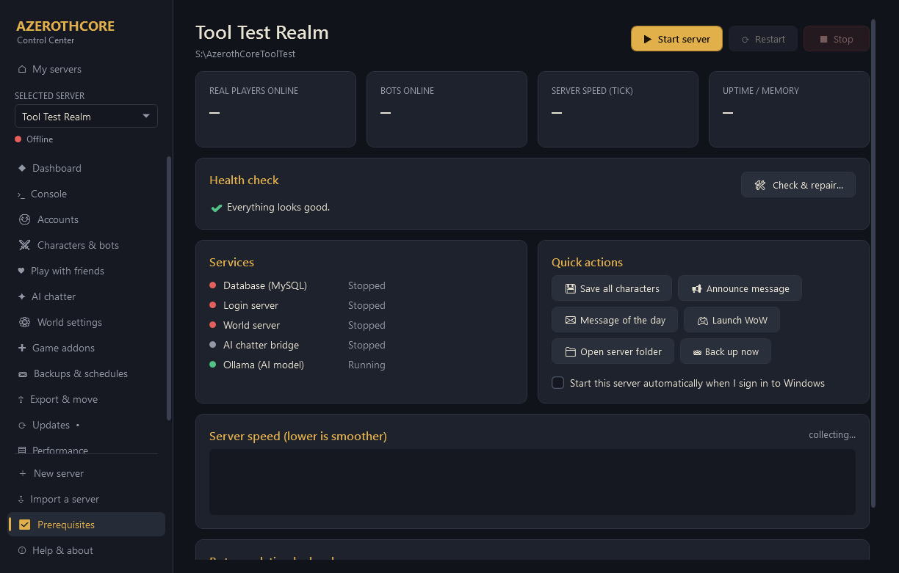

</div>

---

## ✨ What it does

| | |
|---|---|
| 🏗️ **Builds a complete server for you** | Installs everything it needs (compiler, database, libraries), downloads AzerothCore and its modules, compiles them, imports the databases and map data, and creates your game account. Plan on 1-2 hours, mostly unattended. If anything stops, it resumes where it left off. |
| 🤖 **Hundreds of AI players** | Up to 800+ [Playerbots](https://github.com/mod-playerbots/mod-playerbots) that level from 1, form groups, run dungeons, join battlegrounds and fill the auction house. You can even have them **chat using a local AI model** ([Ollama](https://ollama.com)), with nothing sent to the cloud. |
| 🎛️ **Plain-language settings** | Vanilla, TBC or WotLK level cap, PvP or PvE, XP and loot rates, bot counts. Over 100 **Extra settings** (flight paths, starting gold, death penalty, cross-faction play, monster difficulty...), **one-click presets** (Blizzlike, Hardcore, Fast & fun, Instant endgame...), and an **All options** editor for every option in every config file. |
| 🔄 **Safe updates** | See what changed upstream, then update. The new version compiles while you keep playing. A full safety copy is made, the new build is health-checked, and it **rolls back automatically** if anything is wrong. Auto-updates and version pinning are optional. |
| 🛠️ **Check & repair** | Around 30 checks that find the usual ways a server breaks: a moved folder, missing files, a database that won't start, a broken admin login, stale scheduled tasks, busy ports and more. It repairs them after you confirm. Recompile and clean recompile are one click each. |
| 👥 **Play with friends** | Same house, a free VPN (Tailscale), or port forwarding. It sets up the firewall rules and gives you a "join kit" to send your friends. Optional **Discord notifications** cover online/offline, logins, crashes and updates. |
| 💾 **Backups & moving** | Daily backups, save points you can roll back to, an extra copy on another drive or cloud folder, and **export the whole server to one file** to move it to a laptop with no compiling needed. |
| 🧩 **Modules on a switch** | Auction House Bot, Dungeon Clear, AI Chatter, Dungeon Master, account-wide mounts, plus 12 community modules (AutoBalance, Transmog, Solo dungeon finder, Individual Progression, PTR character templates...). Each one is added or removed through the same safe pipeline. |
| 🖥️ **Several servers** | Each server lives in its own folder with its own database. One runs at a time, and idle servers use no memory. By default all servers **share one database port** and starting a server swaps its database in automatically (every connection is checked to reach the right server's data). Duplicate a server, copy characters between servers, and run timed events like double-XP weekends. |

---

## 🚀 Quick start

1. **Download** the latest `AzerothCore-ServerManager-vX.Y.Z.zip` from
   [**Releases**](https://github.com/clawdroppin/AzerothCore-ServerManager/releases/latest) and unzip it anywhere,
   for example `C:\Games\AzerothCore-ServerManager`.
   > If Windows marks the download as "from the internet", right-click the zip → **Properties** → tick
   > **Unblock** → OK *before* unzipping.
2. Double-click **`AzerothCoreCreationTool.bat`** and click **Yes** when Windows asks for permission.
   The app needs admin rights to install prerequisites, create the database service and set up firewall rules.
3. Click **Create a new server** and follow the 4 steps:
   1. **Your PC**: the app checks your hardware and suggests a bot count.
   2. **Your game**: point it at your `Wow.exe` (3.3.5a, build 12340).
   3. **Your world**: name it, then pick a game version, PvP/PvE, rates, bots, modules and AI chat.
   4. **Your login**: choose a username and password for the game.
4. Wait for the build (1-2 hours on a first install; later servers are much faster). Then press **▶ Start**, launch
   WoW, and log in. The realmlist is set up for you.

> **Already have an AzerothCore server?** Use **My servers → Add existing folder**. Your hand-edited
> config values are kept and shown under *All options*.
>
> **Moving a server from another PC?** Export it there (**Export & move**), then use **Import a server** here.

<details>
<summary><b>Only want the prerequisites?</b></summary>

`tools\PrereqInstaller\PrereqInstaller.bat` opens the app directly on the *Prerequisites* page, where each
component can be installed silently or with its normal installer.
</details>

---

## 📋 Requirements

| | Minimum | Recommended |
|---|---|---|
| **OS** | Windows 10 64-bit | Windows 11 |
| **RAM** | 16 GB | 32-64 GB for 500+ bots |
| **Disk** | 30 GB free per server (build) / 10 GB (imported) | SSD |
| **CPU** | 4 cores | 8+ cores (compiling and many bots) |
| **GPU** | n/a | NVIDIA, 8 GB+ VRAM, for AI bot chat |
| **Game** | WoW **3.3.5a (12340)** client | You must own a legitimate copy |

Installed automatically, and only if missing: Visual C++ runtime, Git, CMake, Visual Studio 2022 Build Tools (C++),
Boost 1.81, OpenSSL 3, and a private MySQL 8.4 per server. Python and Ollama are added only with AI chat.
HeidiSQL and Tailscale are optional.

---

## 🖼️ Screenshots

<table>
<tr>
<td width="50%">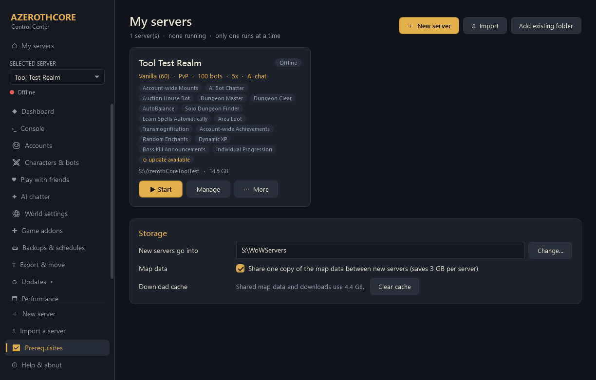<br/><sub><b>My servers:</b> every server on one page.</sub></td>
<td width="50%">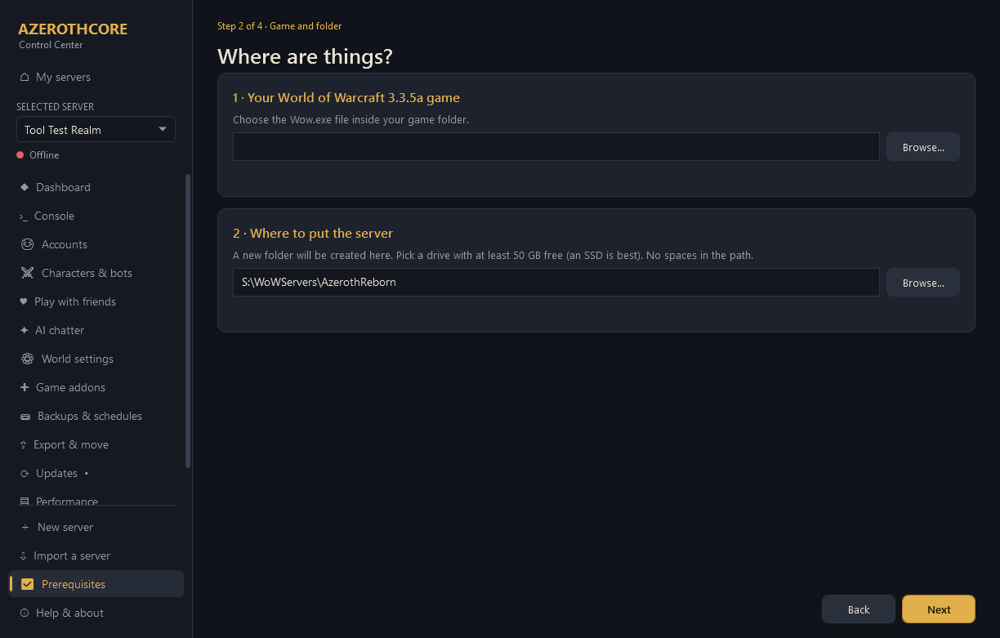<br/><sub><b>New server:</b> four steps, sensible defaults.</sub></td>
</tr>
<tr>
<td>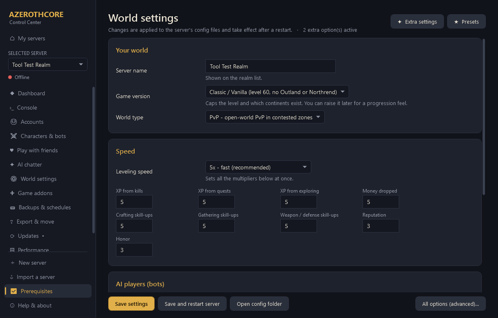<br/><sub><b>World settings</b> in plain language.</sub></td>
<td>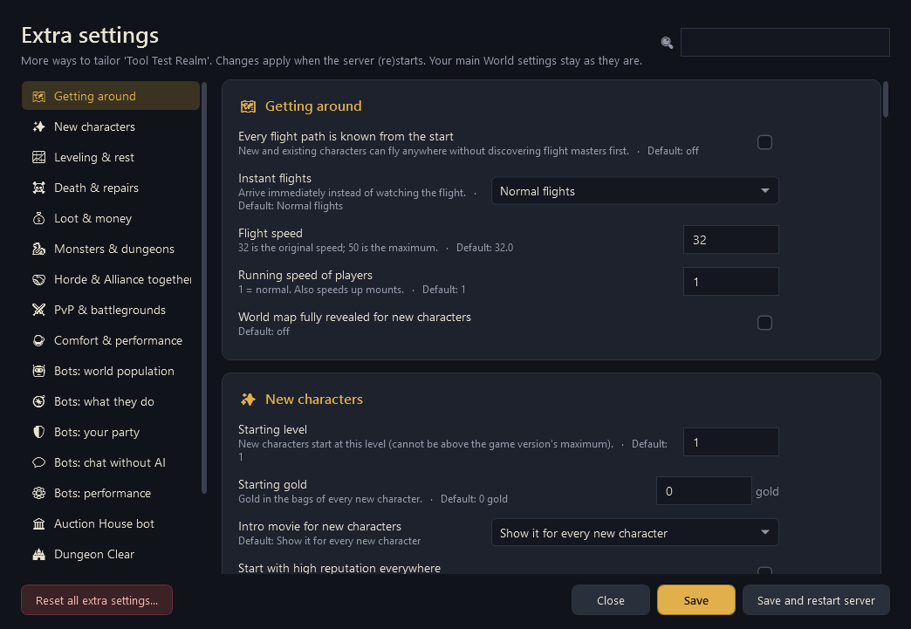<br/><sub><b>Extra settings:</b> 100+ toggles, each with a reset button.</sub></td>
</tr>
<tr>
<td>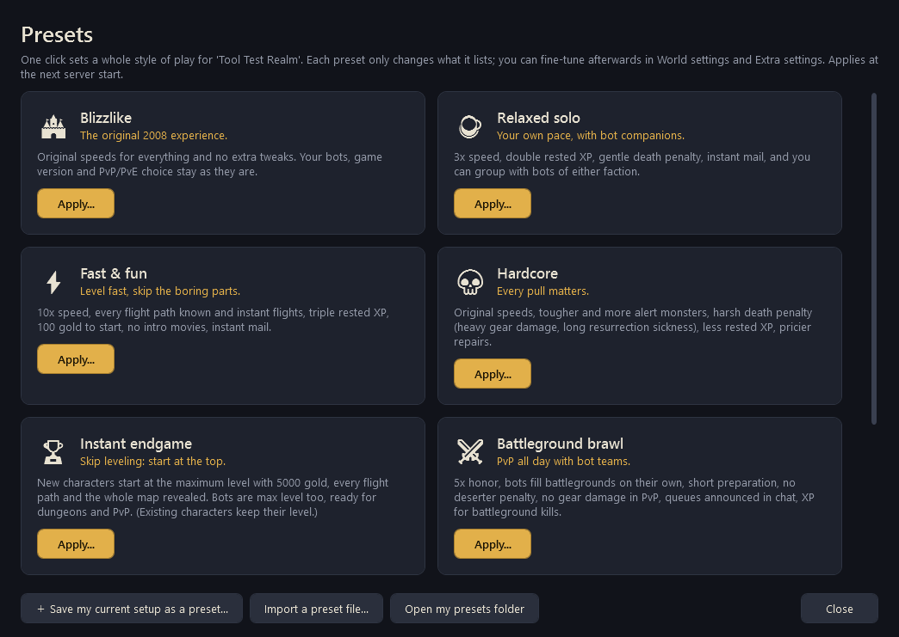<br/><sub><b>Presets:</b> a whole play style in one click, and shareable.</sub></td>
<td>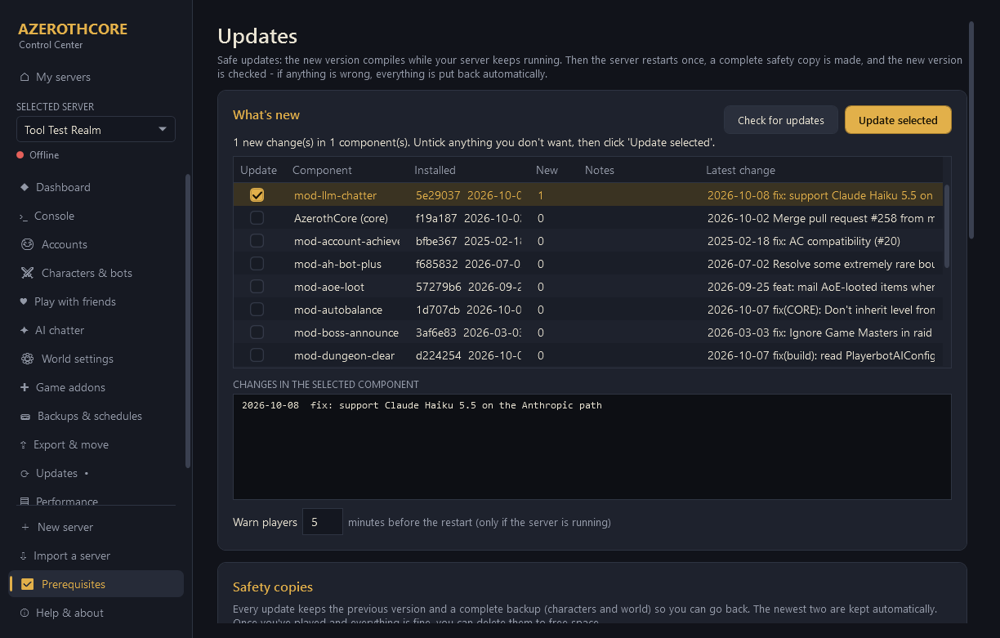<br/><sub><b>Safe updates</b> with changelogs, safety copies and rollback.</sub></td>
</tr>
<tr>
<td>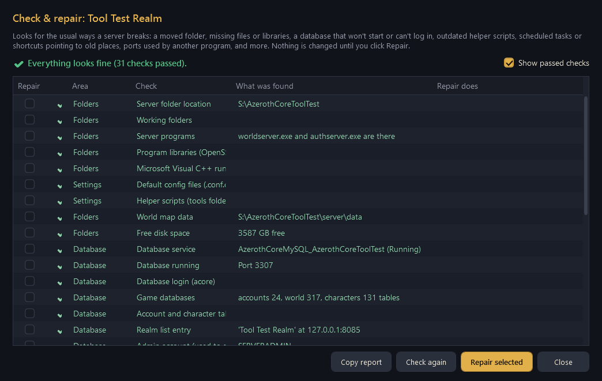<br/><sub><b>Check & repair:</b> about 30 health checks with one-click fixes.</sub></td>
<td>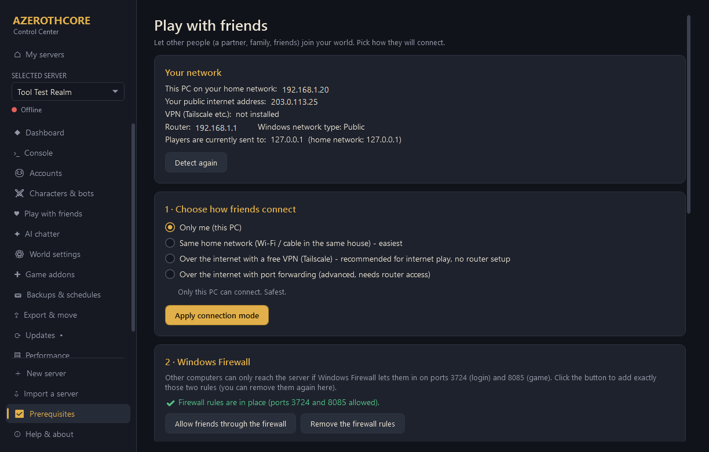<br/><sub><b>Play with friends:</b> LAN, VPN or port forwarding, plus Discord.</sub></td>
</tr>
<tr>
<td>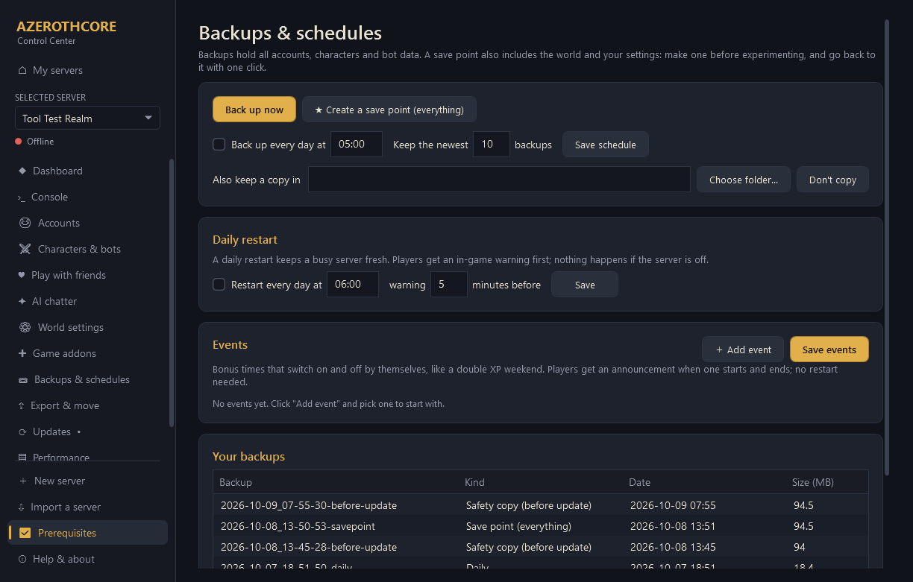<br/><sub><b>Backups & schedules:</b> save points, timed events, daily restarts.</sub></td>
<td>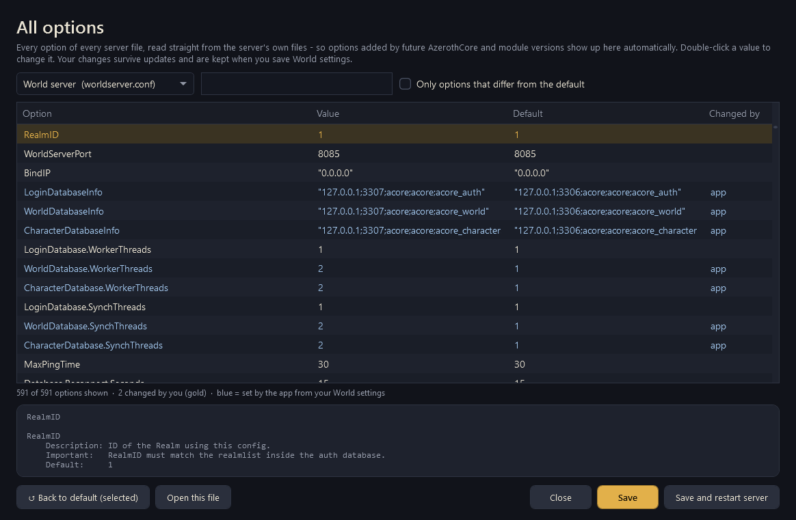<br/><sub><b>All options:</b> every config key, searchable, with descriptions.</sub></td>
</tr>
</table>

---

## 🧭 Features

<details open>
<summary><b>Pages at a glance</b></summary>

| Page | What you can do |
|---|---|
| **My servers** | Start, stop, manage, duplicate, export, check & repair, recompile, free up space, delete |
| **Dashboard** | Players and bots online, server speed (tick) graph, health check, services, quick actions (save, announce, MOTD, launch WoW, back up), start with Windows |
| **Console** | Any GM command on the live server, with history |
| **Accounts** | Create logins, reset passwords, set GM levels, ban or unban, delete |
| **Characters & bots** | Browse players and bots; kick, teleport, set level, mail gold, **mail items** (searchable, quality-coloured), **copy a character to another server** |
| **Play with friends** | Connection mode, firewall rules, a join kit for friends, Discord notifications |
| **AI chatter** | Turn AI bot chat on or off, pick, download and test a model, and set how chatty bots are |
| **World settings** | The basics, plus **Extra settings**, **Presets** and **All options (advanced)** |
| **Game addons** | One-click MultiBot, Dungeon Clear panel, Chatter Companion |
| **Backups & schedules** | Back up now, save points, daily backups, copy to another drive, daily restart, timed events |
| **Export & move** | Pack the server into one `.wowserver` file (full or characters-only) |
| **Updates** | Safe updates, safety copies, auto-update, pinning, modules, **recompile / clean recompile** |
| **Performance** | CPU, RAM and VRAM use, what is using them, and a suggested bot count |
| **Logs** | Server logs with a filter and live follow |
| **Prerequisites** | What is installed or missing, with silent or guided installs |
| **Help & about** | In-game cheat sheet, app version, **check for app updates** |
</details>

<details>
<summary><b>Modules you can switch on</b></summary>

| Module | What it adds |
|---|---|
| [Playerbots](https://github.com/mod-playerbots/mod-playerbots) *(always on)* | AI players that fill the world |
| [Auction House Bot](https://github.com/NathanHandley/mod-ah-bot-plus) | A stocked, living auction house |
| [Dungeon Clear](https://github.com/jrad7/mod-dungeon-clear) | Bots that clear dungeons with you |
| [AI Bot Chatter](https://github.com/Hokken/mod-llm-chatter) | Bots chat using a local AI model |
| [Dungeon Master](https://github.com/trauntrow/mod-dungeon-master) | Dungeon Master tools and events |
| [Account-wide Mounts](https://github.com/pangolp/mod-mounts-on-account) | Mounts shared by all your characters |
| [AutoBalance](https://github.com/azerothcore/mod-autobalance) | Dungeons scale to your group size |
| [Solo Dungeon Finder](https://github.com/azerothcore/mod-solo-lfg) | Queue for dungeons alone |
| [Learn Spells Automatically](https://github.com/azerothcore/mod-learn-spells) | No more trips to the trainer |
| [Area Loot](https://github.com/azerothcore/mod-aoe-loot) | Loot every nearby corpse at once |
| [Transmogrification](https://github.com/azerothcore/mod-transmog) | Change how your gear looks |
| [Account-wide Achievements](https://github.com/azerothcore/mod-account-achievements) | Achievements shared between characters |
| [Random Enchants](https://github.com/azerothcore/mod-random-enchants) | Random bonus stats on loot |
| [Dynamic XP](https://github.com/azerothcore/mod-dynamic-xp) | XP rate that changes with level |
| [Boss Kill Announcements](https://github.com/azerothcore/mod-boss-announcer) | Server-wide boss kill messages |
| [Skip the Death Knight Intro](https://github.com/azerothcore/mod-skip-dk-starting-area) | Skip the DK starting area (WotLK) |
| [Individual Progression](https://github.com/ZhengPeiRu21/mod-individual-progression) | Vanilla → TBC → WotLK progression per player |
| [PTR Character Templates](https://github.com/azerothcore/mod-ptr-template) | Blizzard's test-realm premades: `.template apply` makes a ready level 80/70 character (gear, spells, skills, flights) |
</details>

<details>
<summary><b>How safe updates work</b></summary>

1. **Check for updates** lists the new commits for AzerothCore and each module, and flags database changes.
2. The new version **compiles next to the running server**, so players stay online.
3. Players get an in-game warning, the server stops, and a **complete safety copy** is saved (characters, world,
   settings and the current programs).
4. The new version starts and is **watched for two minutes**. If it crashes or stops answering, everything is
   put back automatically.
5. If a module doesn't compile with the new AzerothCore yet, **nothing is changed** and you choose: update
   without that module, keep AzerothCore as it is, or wait.

The newest two safety copies are kept, and you can delete them once you're happy. **Go back** restores any kept
version. Automatic updates (weekly or daily) only run when no real player is online.
</details>

<details>
<summary><b>What Check & repair looks at</b></summary>

- **Folders:** a moved or renamed server folder, missing working folders, server programs, OpenSSL/MySQL libraries,
  the Visual C++ runtime, map data, free disk space
- **Database:** the service (re-pointed to the folder if it moved), that it starts, the `acore` login, the game
  databases, key tables, the realm list entry, the admin (SOAP) account, auction house sellers, incomplete
  character records
- **Settings:** default config files, generated config files, helper scripts
- **Programs:** leftover server processes, game ports used by another program
- **Source code:** repository health, module sources, a build folder made for another location, build tools
- **App & Windows:** the app's server list, scheduled tasks, desktop shortcuts, the firewall for friends
- **AI chatter:** the bridge's Python environment, Ollama and the model

Nothing changes until you confirm. Each run writes a log to `<server>\.creationtool\repair-<date>.log`, and
**Copy report** puts the results on your clipboard so you can paste them into an issue.
</details>

---

## 🎮 Everyday use

- **Start or stop** from *My servers*, the *Dashboard*, or the `Start <server>` / `Stop <server>` desktop
  shortcuts. **Always stop the server this way**, so every character is saved first.
- Without the app, each server folder has `START_SERVER.bat`, `STOP_SERVER.bat`, `SERVER_STATUS.bat` and
  `CREATE_ACCOUNT.bat`. None of them need admin rights.
- Handy in-game commands for bots: `.playerbots bot add <name>`, invite bots with `/invite`, and use
  the **MultiBot** addon (Game addons page) for a point-and-click bot control panel.

---

## ❓ FAQ & troubleshooting

<details>
<summary><b>Something isn't working. Where do I start?</b></summary>

Open **Dashboard → 🛠 Check & repair**. It finds and fixes most problems. If it can't, click **Copy report**
and [open an issue](https://github.com/clawdroppin/AzerothCore-ServerManager/issues/new/choose) with it.
</details>

<details>
<summary><b>The install stopped with an error.</b></summary>

Click **Try again**: every step is safe to repeat, and it continues where it stopped. For *"Compile failed"*,
close big programs (games, browsers, local AI apps) to free memory, then retry. The app then automatically uses
fewer compiler threads. Full logs are in `<server folder>\.creationtool\`.
</details>

<details>
<summary><b>Can my friends join?</b></summary>

Yes, on the **Play with friends** page. The easiest way over the internet is the free Tailscale VPN, which needs
no router setup. Each friend needs their own 3.3.5a client and an account you create for them on the *Accounts*
page.
</details>

<details>
<summary><b>How many bots can my PC run?</b></summary>

The **Performance** page measures your PC and suggests a number. As a rough guide, the app suggests 100 bots
below 16 GB of RAM, 250 with 16 GB, 500 with 32 GB and 800 with 48 GB or more. A modern 8-core CPU with 64 GB runs
800 bots at a 1-2 ms tick.
</details>

<details>
<summary><b>Does it change my game client?</b></summary>

Only `realmlist.wtf` and the realm entries in `WTF\Config.wtf`, so the client connects to your server.
The originals are backed up to `<server>\.creationtool\client-backup\`.
</details>

<details>
<summary><b>Which ports do I need to forward for online play?</b></summary>

Only the two game ports: **3724** (login) and **8085** (game). They're the same for every server you make. The
database port is only used inside your PC, so it never needs forwarding. When you create a server you choose between
a **shared database port** (recommended: one port for all your servers, swapped automatically when you start one) or
**its own port** (that server's database can stay available while another server runs).
</details>

<details>
<summary><b>How do I update this app?</b></summary>

**Help & about → Check for app updates** (the app also checks once a day). Download the new zip, close the
app, and unzip it over the old folder. Your servers live in their own folders and aren't touched.
</details>

<details>
<summary><b>Where are my passwords?</b></summary>

In each server's `secrets\` folder. That covers your game login, the admin (SOAP) login used for clean stops,
and the database administrator password. They never leave your PC, and exports only include them if you tick
that option.
</details>

---

## 🧑‍💻 For developers and AI agents

The whole app is **PowerShell 5.1 + WPF**, so there's nothing to build. Clone the repo and run
`AzerothCoreCreationTool.bat`.

- 📘 **[AGENTS.md](AGENTS.md)** is the complete guide for AI coding agents and human contributors: architecture,
  data flow, conventions, the PowerShell 5.1 pitfalls we hit, how to add settings, presets, modules and repair
  checks, and how to test without risking anyone's real server.
- 🤝 **[CONTRIBUTING.md](CONTRIBUTING.md)** covers the workflow, checks and release process.
- 📝 **[CHANGELOG.md](CHANGELOG.md)** shows what changed in each version.

```powershell
# static checks (syntax, encodings, XAML/JSON, closure pitfalls) - run before every commit
powershell -NoProfile -ExecutionPolicy Bypass -File tools\dev\Invoke-StaticChecks.ps1
# load every page and window without showing the app (0 handler errors expected)
powershell -NoProfile -STA -ExecutionPolicy Bypass -File src\App.ps1 -SelfTest
```

<details>
<summary><b>Project layout</b></summary>

```
AzerothCoreCreationTool.bat   launcher (asks for admin, starts src\App.ps1)
src\
  App.ps1        WPF app: pages, event handlers, background-task runner, self-test
  Windows.ps1    Extra settings, Presets and All options windows
  Dialogs.ps1    Small dialogs: choice, item picker, character copy, Check & repair
  Manage.ps1     Back end for installed servers (status, SQL, SOAP, backups, events, settings...)
  Steps.ps1      Install steps (idempotent, resumable) and the compiler driver
  Update.ps1     Safe updates, rollback, recompile, module add/remove, auto-update
  Repair.ps1     Check & repair checks and fixes
  Prereqs.ps1    Prerequisite catalogue: detect / download / verify / install
  Common.ps1     Shared helpers (logging, downloads, native calls, machine profile)
  Headless.ps1   Entry point for scheduled tasks (auto-update, timed events)
ui\              App.xaml (all pages), Theme.xaml (dark theme), icon
config\          versions.json (sources, modules, prerequisites), extras.json, presets.json, app.json
payload\         Scripts copied into every server folder (START/STOP .bat, ServerControl, apply-config...)
tools\           PrereqInstaller launcher, dev\Invoke-StaticChecks.ps1
```
</details>

---

## 🙏 Credits

This project stands on the shoulders of these communities:

- [**AzerothCore**](https://github.com/azerothcore/azerothcore-wotlk): the open-source WoW 3.3.5a server emulator
- [**mod-playerbots**](https://github.com/mod-playerbots/mod-playerbots) and its
  [AzerothCore fork](https://github.com/mod-playerbots/azerothcore-wotlk): the AI players
- The authors of every module listed above
- [**wowgaming/client-data**](https://github.com/wowgaming/client-data): pre-extracted map data
- [Ollama](https://ollama.com) for local AI models, and [Tailscale](https://tailscale.com) for easy friend access

## ⚖️ License & disclaimer

The code in this repository is released under the **[MIT License](LICENSE)**: use it, change it, share it.
AzerothCore, the modules and the other tools it downloads keep their own licenses (AzerothCore is AGPL-3.0).

This project is **not affiliated with or endorsed by Blizzard Entertainment**. World of Warcraft® is a registered
trademark of Blizzard Entertainment, Inc. No game files are included or distributed. You need your own
legitimate game client. Intended for private, personal and educational use.

<div align="center"><sub>Made with ❤️ for everyone who misses Azeroth the way it was.</sub></div>
